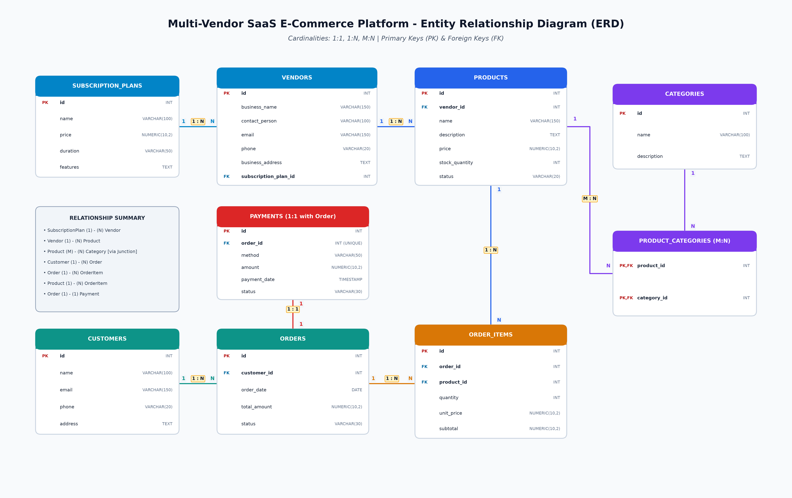
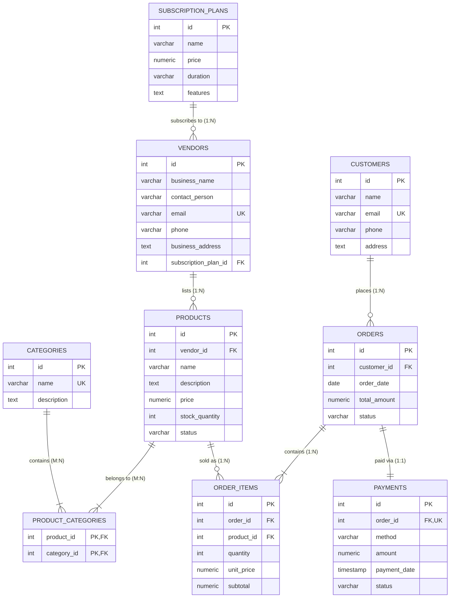

# Multi-Vendor SaaS E-Commerce Database Design

This project contains the relational database design, ERD diagram, DDL schema, DML operations, and analytical SQL queries for a Multi-Vendor SaaS E-Commerce platform.

---

## 1. System Overview & Relationships

The platform connects multiple independent vendors, product catalogs, customer orders, and payment transactions under a subscription model.

### Entity Relationships & Cardinalities

| Entity A | Relationship | Entity B | Cardinality | Reason |
| :--- | :--- | :--- | :---: | :--- |
| **SubscriptionPlan** | offers to | **Vendor** | `1:N` | A plan can have many vendors; a vendor subscribes to one plan at a time. |
| **Vendor** | lists | **Product** | `1:N` | One vendor can list many products; each product belongs to exactly one vendor. |
| **Product** | categorized in | **Category** | `M:N` | A product can appear in multiple categories, and a category contains multiple products (resolved via `product_categories`). |
| **Customer** | places | **Order** | `1:N` | A customer can place multiple orders; an order belongs to one customer. |
| **Order** | contains | **OrderItem** | `1:N` | An order can contain multiple line items for different products. |
| **Product** | referenced in | **OrderItem** | `1:N` | A single product can appear across multiple order items in different customer orders. |
| **Order** | paid via | **Payment** | `1:1` | Every order has a single associated payment record (enforced with `order_id INT UNIQUE`). |

---

## 2. Entity Relationship Diagram (ERD)





---

## 3. Assignment Solution Summary

All SQL commands are organized inside [`ecommerce_multivendor.sql`](ecommerce_multivendor.sql) with `--` explanatory comments.

### Part B: SQL DDL (Table Creation)
- **Question 3 (`vendors` table):**
  Defines `id` as `SERIAL PRIMARY KEY` and creates a foreign key `subscription_plan_id` referencing `subscription_plans(id)`.
- **Question 4 (`product_categories` table):**
  Resolves the `M:N` relationship between `products` and `categories` using a composite primary key `(product_id, category_id)` and cascade foreign keys.

### Part C: SQL DML (Insert / Update / Delete)
- **Question 5:** Inserts vendor `"SmartTech Ltd."` with contact `"Rahim Khan"` under the `"Basic"` subscription plan dynamically.
- **Question 6:** Inserts product `"Laptop"` (price: 75,000, stock: 10, status: active) for SmartTech Ltd., and creates the link record in `product_categories` for the `"Electronics"` category.
- **Question 7:** Updates Laptop stock quantity from 10 to 15.
- **Question 8:** Deletes customer with email `"oldcustomer@gmail.com"`.

### Part D: SQL Queries (DQL)
- **Question 9:** Displays all vendors joined with their subscription plan name and price.
- **Question 10:** Retrieves all products belonging to the `"Electronics"` category via the junction table.
- **Question 11:** Lists all orders placed by customer `"Karim Uddin"` with date, total, and status.
- **Question 12:** Returns payment record for `order_id = 1`.
- **Question 13:** Aggregates order item quantities grouped by product to identify the top 5 best-selling products (`ORDER BY total_quantity_sold DESC LIMIT 5`).

---

## 4. How to Run the SQL Script

You can run `ecommerce_multivendor.sql` using any PostgreSQL client:

### Using psql (Command Line)
```bash
psql -U postgres -d postgres -f ecommerce_multivendor.sql
```

### Using pgAdmin / DBeaver / Datagrip
1. Connect to your PostgreSQL database.
2. Open `ecommerce_multivendor.sql` in the Query Tool.
3. Click **Execute / Run** (F5).
4. Review the returned result grids for queries 9 through 13.
